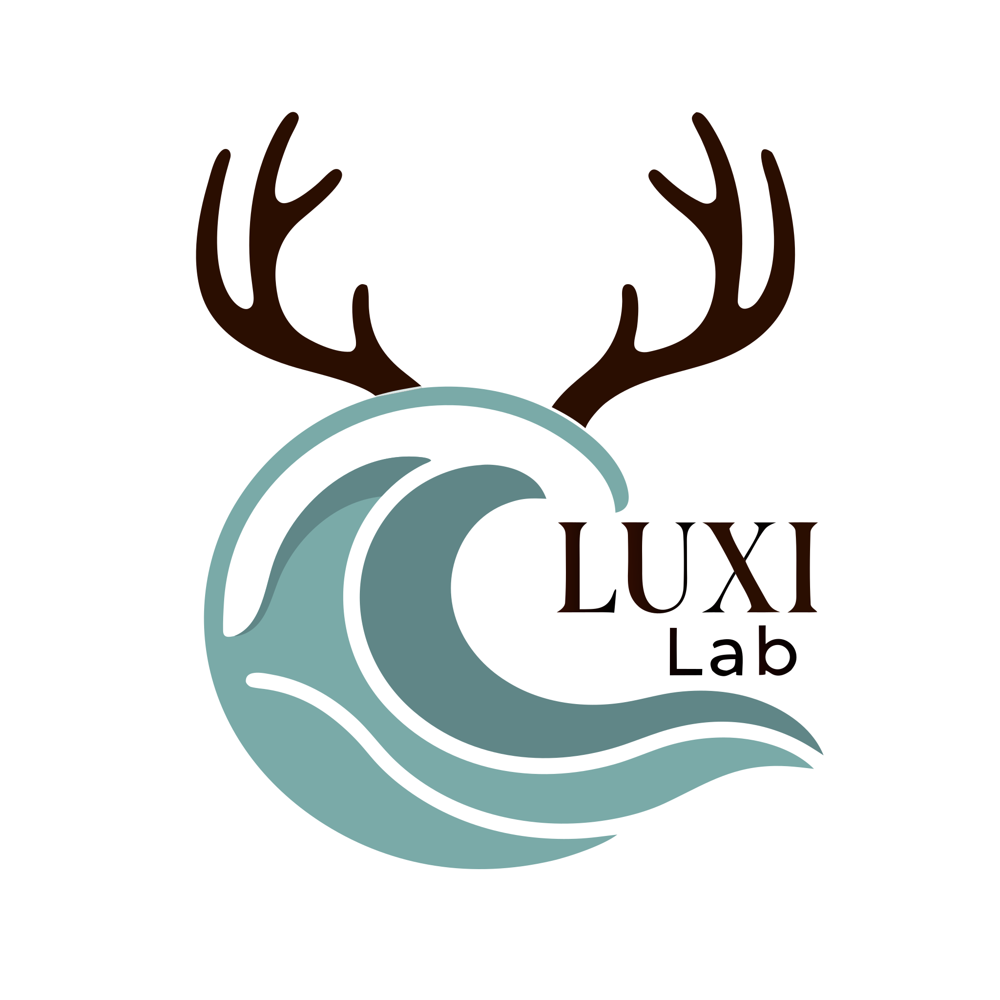

<div align="center">
  
  &nbsp;&nbsp;
  
</div>

<h1 align="center">澄矩 · ChengJu（IQS）</h1>

<p align="center">
  <strong>源清流澈，行止应矩</strong><br/>
  <em>Purity in quality stream, precision within bounded rules.</em><br/>
  自研 <strong>IQS-DSL</strong> + AI 推理 + MCP 渲染 · 工业级 QC 图表平台
</p>

<p align="center">
  
  
  
  
  
  
  
</p>

<p align="center">
  <b>鹿溪联合创新实验室</b>（LUXI Joint Innovation Lab）出品 · 著作权人：江西省上饶市烟草专卖局（公司）<br/>
  仓库：<a href="https://github.com/itrilogy/LUCY-CHENGJU">itrilogy/LUCY-CHENGJU</a>
</p>

---

<p align="center">
  <a href="#快速开始">快速开始</a> ·
  <a href="#核心能力">核心能力</a> ·
  <a href="#图种">图种</a> ·
  <a href="#iqs-flow企业流程图">IQS-Flow</a> ·
  <a href="#ai-生成">AI 生成</a> ·
  <a href="#文档">文档</a> ·
  <a href="#知识产权与版权">版权</a>
</p>

---

## 🎨 产品标识

| 标识 | 预览 | 说明 | 源文件 |
| :---: | :---: | :--- | :--- |
| **产品方标** |  | 控制图折线 + 限线（QC/SPC）· S 形溪流 · 源启星 | `public/brand/iqs-mark.svg` |
| **横版字锁** |  | 横版产品字锁 | `public/brand/iqs-logo.svg` |
| **实验室主标** |  | 官方 LUXI LAB | `public/brand/luxi-lab.svg` |

**色板（LUXI CI）**

| Token | 色值 | 用途 |
| :--- | :--- | :--- |
| 鹿溪绿 | `#0D5E42` | 产品标底、品牌主色 |
| 源启白 | `#F5F7FA` | 面板反白 |
| 进化蓝 | `#00D2FF` | 溪流、源启星、强调 |
| 标题金 | `#F1C40F` | 落点、显著信号 |

**IQS 方标语义**：控制图折线 + 限线（QC/SPC）· S 形溪流（数据流动）· 源启星（智能生成）。

品牌说明：[`public/brand/README.md`](./public/brand/README.md)

---

## 项目简介

**澄矩 · ChengJu（Intelligent QC Studio / IQS）** 是面向质量管理（QC）小组活动与企业体系文件的 Web 工作站。用自研 **IQS-DSL** 把「自然语言 / 专业 DSL」变成可校验、可导出、可被 MCP 调用的图表；AI 只写 DSL，渲染在本地完成。

- 业务遵循 **T/CAQ 10201** 质量管理小组活动相关准则与 **PDCA** 图种覆盖
- **CORE（14）**：鱼骨、排列、直方、控制、散点、雷达、关联、矢线、PDPC、矩阵、图矩阵、亲和、基础图、**企业流程图（IQS-Flow）**
- **RELIEF**：Mermaid / VChart 类型外救济（**不替代** QC / 体系文件终稿）
- 出品标识：**鹿溪联合创新实验室** · 著作权人见文末

当前发行版本 **V3.6.3-ildr**。本版完成了全仓审计（`AUD-195..202`）后的三件事：服务端托管企业模型密钥、生产容器改为单进程双端口、16 类图表与编辑器按需分包。

---

## 核心能力

| 能力 | 说明 |
|:---|:---|
| **IQS-DSL v1.1** | 统一 Shell + Body；`dsl/kinds.json` 注册；卡片真源 `dsl/cards/*`；`npm run validate:dsl` 门禁 |
| **纯解析器解耦** | 全部解析器集中于 `dsl/parsers.ts`，零 React 依赖；视图组件只消费解析结果 |
| **双引擎 + 自研 SVG** | 统计图 ECharts；逻辑图原生 SVG（G6 已全量退场）；**Flow 自研正交 SVG**（零新依赖） |
| **按需分包** | 16 个 `*Diagram` + 16 个 `*Editor` 全部 `React.lazy`；ECharts / VChart / Mermaid / PDF 拆为独立 chunk，首屏不下载图表引擎 |
| **AI 双轨路由** | 企业公共模型池走服务端代理（密钥永不到达浏览器）；个人本地模型（Ollama / LM Studio）由浏览器直连 `127.0.0.1` |
| **MCP** | 同一 Node 进程承载 Web 与 MCP；瘦声明 + `protocol://` 资源；Headless Chromium ILDR 无头出图 |
| **导出** | PNG / PDF；无头桥接 `captureIQSChart`，动态分包下由挂载门闩等待图表就绪 |
| **几何回归** | `test:fishbone`（G1–G7）· `test:relation` · `test:pdpc` · `test:flow`（解析 / SVG / BPMN / 主干序 / 格内序），全部串入 `npm run build` |
| **发行材料** | [`docs/软著与发行/`](./docs/软著与发行/00_文档索引.md) |

### 架构一览

```text
┌──────────────────────────────────────────────────────────────┐
│  UI   Vite 6 · React 19 · Tailwind · 32 个图表/编辑器按需加载  │
├──────────────────────────────────────────────────────────────┤
│  IQS-DSL v1.1   dsl/parsers.ts 纯解析 · kinds 注册 · 卡片真源  │
├──────────────────┬───────────────────┬───────────────────────┤
│  统计图 ECharts  │  逻辑图 原生 SVG   │  Flow 自研 SVG         │
│  排列/直方/控制… │  鱼骨/关联/PDPC…   │  泳道网格 + 正交走线   │
├──────────────────┴───────────────────┴───────────────────────┤
│  AI 双轨   企业池：服务端 /api/ai/* 查表注入密钥转发            │
│            本地池：浏览器直连 127.0.0.1（Ollama / LM Studio）   │
├──────────────────────────────────────────────────────────────┤
│  运行时  单 Node 进程：:12000 Web + API · :12001 MCP SSE       │
│          Headless Chromium 回环截帧 · 渲染快照 TTL 自动回收    │
└──────────────────────────────────────────────────────────────┘
```

### 生产运行时（R33）

生产容器不再运行 `vite preview`。`mcp-server/index.js` 在同一个 Node 22 进程里同时监听两个端口：

| 端口 | 职责 |
|:---|:---|
| **12000** | `dist/` 静态托管、SPA History Fallback、`/api/*`、`/healthz` |
| **12001** | MCP `/sse`、`/messages`、`/renders`、`/api/*`、`/healthz` |

容器以非特权用户 `appuser (10001:10001)` 运行，`tini` 作为 PID 1 回收 Headless Chromium 僵尸进程，镜像内置 `fonts-noto-cjk` 保障中文出图，`no-new-privileges` 与 `shm_size: 512mb` 为无头浏览器提供运行保障。`iqs-data` 与 `iqs-renders` 两个命名卷分别持久化配置和渲染产物，后者按 `IQS_RENDER_TTL_HOURS`（默认 24h）与 `IQS_RENDER_MAX_FILES`（默认 500）自动回收。

---

## 图种

### CORE（14）

| 场景 | kind | MCP |
|:---|:---|:---|
| 根因 / 5M1E | `fishbone` | `render_fishbone` |
| 关键少数 | `pareto` | `render_pareto` |
| 分布 / Cp·Cpk | `histogram` | `render_histogram` |
| SPC 稳定性 | `control` | `render_control` |
| 相关回归 | `scatter` | `render_scatter` |
| 多维对比 | `radar` | `render_radar` |
| 多重因果 | `relation` | `render_relation` |
| 关键路径 | `arrow` | `render_arrow` |
| 预案分支 | `pdpc` | `render_pdpc` |
| 多对多矩阵 | `matrix` | `render_matrix` |
| 多因子图矩阵 | `matrixPlot` | `render_matrix_plot` |
| KJ 亲和 | `affinity` | `render_affinity` |
| 柱线饼 | `basic` | `render_basic` |
| **跨部门审批 / 程序文件** | **`flow`** | **`render_flow`** |

### RELIEF

| 场景 | kind | 约束 |
|:---|:---|:---|
| 类型外结构 / 时序 | `mermaid` | 体系文件流程图终稿禁止用 `flowchart TD` 冒充 `flow` |
| 类型外复杂可视化 | `vchart` | 有 Native 等价时优先 Native |

完整语法 → [**IQS-DSL v1 手册**](./docs/IQS_DSL_V1_MANUAL.md) · 注册表 → [`dsl/kinds.json`](./dsl/kinds.json)

---

## IQS-Flow（企业流程图）

第 14 个 CORE kind。语义是 **BPMN 2.0 子集** + **字典-索引**：谁（泳道）× 做什么（活动）× 走哪条路（网关）。渲染为自研 SVG，不走 Mermaid。

```dsl
Title: 采购申请审批流程
Layout: H
Dict: D[信息中心,综合计划科,办公室]
Dict: P[申请阶段,审批阶段,执行阶段,归档阶段]
Lane from D[0,1,2] Layout H
Lane from P[0,1,2,3] Layout V
Attr active [Role,SOP,Lv,Time,KPI]
W: w1: 提交申请 Type[S] Location(D[0],P[0])
W: q1: 金额超过5000? Type[?] Location(D[0],P[1])
   是 → #w4
   否 → #w5
   End
```

| 能力 | 说明 |
|:---|:---|
| 字典展开 | 图上显示「信息中心」，不显示 `D[0]` |
| 正交走线 | 3×3 绘制格、WSAD 端口硬互斥、A3 同向共干、代数+可见图混合内核 |
| 配色方案 | 默认蓝 / 高反差 / 打印灰 / 青绿 / 暖沙，写入 `Color[Slot]` |
| 泳道线型 | `Grid: dashed`（默认）或 `Grid: solid`（内框与边界同一套） |
| 交叉辨识 | 线序更大的整条连线用连线色×底色的公共差异色 |
| 右下角标注 | 按 `Attr active` 顺序，只标该节点有值项 |
| 回归 | `npm run test:flow`（parser + SVG + BPMN + 主干序 + 格内序） |

手册：[USER_MANUAL_FLOW](docs/flow/manual/USER_MANUAL_FLOW.md) · 规范：[IQS_FLOW_DSL_SPEC](docs/flow/spec/IQS_FLOW_DSL_SPEC.md) · 协议：[protocol/segments/flow.md](./protocol/segments/flow.md)

---

## 🚀 快速开始

### 环境

- **Node.js 22.12+**（`package.json` `engines` 要求；`test:*` 使用 `--experimental-strip-types`；Docker 镜像 `node:22-slim`）
- Chrome / Edge 推荐
- （可选）Docker、大模型 API Key（DeepSeek 等 OpenAI 兼容接口）或本机 Ollama / LM Studio

### 开发模式

```bash
git clone https://github.com/itrilogy/LUCY-CHENGJU.git
cd LUCY-CHENGJU
npm install
cp .env.example .env          # 按需填写，勿提交
npm run validate:dsl
npm run test:flow             # Flow 引擎回归
npm run dev                   # http://localhost:12000
```

若提示 `Port 12000 is in use`：结束占用进程后再启（已 `strictPort`，不会自动换端口）。

开发态的 Mermaid 与 VChart 依赖图很宽，已在 `vite.config.ts` 的 `optimizeDeps.include` 中提前预构建（R34）。若升级依赖后这两个页面首次打开报动态导入失败，删除 `node_modules/.vite` 再重启 `npm run dev`。

### Docker

```bash
cp .env.example .env          # 设置 IQS_ADMIN_PASSWORD，按需设置 API_KEY
docker compose up -d --build
```

| 端口 | 服务 |
|:---|:---|
| **12000** | Web 工作站 + `/api/*` |
| **12001** | MCP SSE |

浏览器：<http://localhost:12000>

两个端口由**同一个 Node 进程**提供，健康检查分别探测 `/healthz`。容器入口只把非敏感的 `AI_ACTIVE_PROFILE` 写入 `dist/config.js`，**不会**注入 `API_KEY` 或管理员口令。

### MCP

需先有可访问的 Web 引擎（默认 `IQS_BASE_URL=http://localhost:12000`）。

```bash
npm run mcp:stdio       # 本地 AI 客户端
npm run mcp:sse         # http://localhost:12001/sse
```

| 资源 | 说明 |
|:---|:---|
| `protocol://dsl/v1` | 语言红线摘要 |
| `protocol://governance` | CORE / RELIEF |
| `protocol://segments/iqs_native/{kind}` | 单图完整语法 + 示例 |
| `protocol://segments/iqs_native/flow` | IQS-Flow 编译卡（外部模型写 Flow 必读） |

外部 LLM 画体系文件流程图应调用 **`render_flow`**，禁止用 Mermaid `flowchart TD` 充当终稿。

### 常用脚本

| 命令 | 说明 |
|:---|:---|
| `npm run dev` | 同步 MCP 清单 + Vite 开发服务器（`:12000`） |
| `npm run test:fishbone` | 鱼骨图几何不变量 G1–G7 |
| `npm run test:relation` | 关联图因果代数断言 |
| `npm run test:pdpc` | PDPC 几何断言 |
| `npm run test:flow` | Flow 解析 / SVG / BPMN / 序断言 |
| `npm run validate:dsl` | 语法手册 / 示例 / 卡片契约校验 |
| `npm run validate:cards` | 卡片真源快照校验 |
| `npm run build` | 全部校验与断言 + MCP Linter 打包 + 生产构建 |
| `npm run preview` | 预览构建产物 |
| `npm run sync-tools` | `mcp-server/mcp_tools.json` → `public/` |
| `npm run mcp:stdio` / `mcp:sse` | 启动 MCP |

---

## AI 生成

编辑器「AI 推理」把自然语言编成当前 kind 的 IQS-DSL，再交给本地解析器与渲染器。模型接入分两条轨，密钥的去向不同。

### 企业公共模型池（`source: admin`）

密钥只存在于服务端 `data/ai_config.json`。浏览器拿到的配置里 `apiKey` 恒为空，仅附 `hasApiKey` 与 `maskedKey`。

| 接口 | 作用 |
|:---|:---|
| `POST /api/admin/login` | 管理员口令校验，签发 `HttpOnly; SameSite=Lax` 会话 Cookie |
| `PUT /api/admin/ai-config` | 原子写入模型配置；留空的密钥沿用旧值 |
| `POST /api/ai/chat` | 只接收 `profileId`、`prompt`、`systemInstruction`，服务端查表注入密钥转发 |
| `POST /api/ai/models` | 服务端代拉远端模型列表 |

口令以 SHA-256 存储并用常量时间比对，单 IP 5 分钟内最多 10 次尝试。`/api/ai/chat` 只能转发到已登记的 `profileId`，不接受任意地址，避免被当作开放代理。

```bash
# .env（已被 gitignore，勿提交真实密钥）
IQS_ADMIN_PASSWORD=your-admin-password
AI_ACTIVE_PROFILE=deepseek_public
```

### 个人本地模型（`source: client_cookie`）

Ollama、LM Studio 等跑在 `127.0.0.1` 的服务由浏览器直接连接，配置留在本机 Cookie 与 `localStorage`，不经过服务端落盘。这是为了保留本地模型能力，同时不把企业密钥下发到前端。

**不要把 API Key 或管理员口令写进 `public/config.js`、`dist/` 或 `window.APP_CONFIG`，不要提交 `.env`。** CI 对构建产物做零密钥扫描。

---

## 📁 项目结构

```text
LUCY-CHENGJU/
├── App.tsx / index.tsx              # 应用入口；32 个图表/编辑器 React.lazy
├── components/                      # *Diagram + *Editor + ui/ErrorBoundary
│   └── flow/                        # IQS-Flow：解析 / 布局 / 路由 / SVG / 编辑器
├── dsl/
│   ├── parsers.ts                   # 16 类图表纯解析器（零 React 依赖）
│   ├── kinds.json                   # CORE / RELIEF 注册表
│   └── cards/                       # 卡片真源：语法 / 示例 / 反例 / 提示词
├── services/aiService.ts            # 双轨路由：企业池走 /api/ai/*，本地池直连
├── public/
│   ├── brand/                       # IQS + 鹿溪实验室标识
│   ├── config.json                  # AI profile（endpoint / model，无密钥）
│   ├── config.js                    # 运行时占位（仅 AI_ACTIVE_PROFILE）
│   └── mcp_tools.json               # 由 sync-tools 同步
├── mcp-server/
│   ├── index.js                     # 单进程双端口：Web :12000 + MCP :12001
│   ├── api.js                       # 鉴权 / 配置 / 模型代理（开发与生产共用）
│   └── lib/flow_lint.mjs            # Flow 诊断打包产物
├── protocol/                        # governance · DSL_V1 · segments
├── scripts/                         # assert_* 几何门禁 · validate_* · 卡片构建
├── docs/
│   ├── PROJECT_INDEX.md             # 全项目文档总索引
│   ├── IQS_DSL_V1_MANUAL.md         # DSL 细粒度手册
│   ├── flow/                        # IQS-Flow 专项子索引
│   └── 软著与发行/
├── Dockerfile · docker-compose.yml · docker-entrypoint.sh
└── package.json                     # 3.6.3-ildr · UNLICENSED
```

---

## 📚 文档

| 文档 | 说明 |
|:---|:---|
| **[项目文档总索引与工程历程](./docs/PROJECT_INDEX.md)** | **全项目文档 MOC**：时间线（2026-02-05 → 10-30）+ 分类登记 + 权威层级 |
| **[R33 审计与容器加固工程记录](./docs/IQS_AUDIT_AND_CONTAINER_HARDENING_R33.md)** | 双轨密钥隔离、单进程双端口、按需分包、`AUD-195..202` 台账 |
| **[R34 开发态依赖预构建](./docs/IQS_DEV_DEPS_OPTIMIZER_R34_DESIGN.md)** | Mermaid / VChart 动态导入 504 的根因与 `optimizeDeps.include` 修复 |
| **[IQS-DSL v1 完整手册](./docs/IQS_DSL_V1_MANUAL.md)** | 14 个 CORE kind 指令表 / Body / 示例 / 反例 |
| **[卡片真源 `dsl/cards/*`](./dsl/cards/)** | **唯一真源**：语法/示例/反例/提示词，MCP 与帮助弹窗均由它生成 |
| [IQS-DSL 架构 SPEC](./docs/IQS_DSL_V1_SPEC.md) | 分层与权威序 |
| **[IQS-Flow 规范](docs/flow/spec/IQS_FLOW_DSL_SPEC.md)** | 字典-索引、泳道、BPMN 子集、渲染规格 |
| [IQS-Flow 文档索引](docs/flow/README.md) | FLOW 专项子索引 |
| [IQS-Flow 用户手册](docs/flow/manual/USER_MANUAL_FLOW.md) | 30 秒出图、属性、走线、FAQ |
| [Flow 最优性框架](docs/flow/math/FLOW_OPTIMALITY_FRAMEWORK.md) | 布局/布线承诺分层（一般图不承诺全局最优） |
| [软著与发行 · 索引](./docs/软著与发行/00_文档索引.md) | 登记表、说明书、安装发行、检查清单 |
| [安装部署与发行指南](./docs/软著与发行/04_安装部署与发行指南.md) | 源码 / Docker / 验收 |
| [协议治理](./protocol/governance.md) | CORE / RELIEF |
| [意图路由目录](./protocol/intents.md) | `protocol://intents` —— 生成前先读，按意图定位 kind |
| [分图用户手册](./docs/) | `IQS_COMP_MANUAL_*.md` |
| [CHANGELOG](./CHANGELOG.md) | 版本变更 |
| [COPYRIGHT](./COPYRIGHT.md) · [NOTICE](./NOTICE.md) | 版权与第三方 |

---

## ⚖️ 知识产权与版权

| 类型 | 内容 | 状态 |
|:---|:---|:---|
| 软著 ×2 | ① DSL 图表引擎 **V3.5** ② MCP 服务 **V2.7** | 材料见 `docs/软著与发行/` |
| 发明专利 ×2 | DSL 生成方法 · LLM 自纠正等 | 技术交底另册 |

**著作权人：江西省上饶市烟草专卖局（公司）**  
开发：信息中心 · 品牌协作标识：鹿溪联合创新实验室

本软件为 **专有软件（Proprietary / UNLICENSED）**。未经书面授权，不得复制、分发或用于约定外用途。  
第三方开源组件见 [`NOTICE.md`](./NOTICE.md)。

---

## 贡献与支持

内部项目：需求与缺陷请通过单位既定流程反馈至 **信息中心 / IQS 项目组**。  
发行验收清单：[`docs/软著与发行/09_发行检查清单.md`](./docs/软著与发行/09_发行检查清单.md)。

---

<div align="center">
  
  <p><strong>澄矩 · ChengJu</strong> · 源清流澈，行止应矩</p>
  <p>© 2026 江西省上饶市烟草专卖局（公司）信息中心 · 鹿溪联合创新实验室 · LUXI Joint Innovation Lab</p>
  <p><em>林深见鹿，源启清溪 · Deep Insights, Evolutionary Origin.</em></p>
</div>
