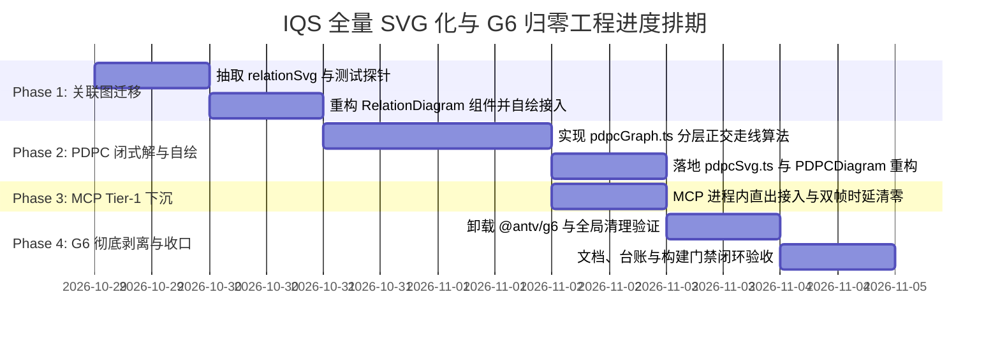

# 澄矩 (IQS) 图表引擎全量 SVG 化与 G6 归零设计规划书

> **设计主旨**：继 **IQS-Flow**（R21 原生自研 SVG）与 **Fishbone 鱼骨图**（R29 闭式拓扑 + 自绘 SVG 归位）成功落地后，彻底剥离全仓对第三方重量级图可视化库 `@antv/g6`（v5.0.51，打包产物体积约 1.8MB）的残留依赖。  
> 将仅存的两个 G6 依赖组件 —— **关联图（Relation Diagram）** 与 **过程决策程序图（PDPC Diagram）**，全面迁移至**「纯数学闭式拓扑计算 + 轻量原生自绘 SVG 渲染 + 进程内 Tier-1 直出」**的统一工程架构范式。

---

## 1. 背景与迁移必要性

### 1.1 现状依赖清单（As-Is）

全仓 14 种 CORE 图表中，渲染承载形态当前分化为 4 大派系：

| 派系 | 图表种类 | 渲染实现 | MCP 直出通道 | G6 依赖 |
|:---|:---|:---|:---|:---:|
| **自研原生 SVG 派** | **Flow**, **Fishbone**, **Arrow**, **Affinity**, **Matrix**, **MatrixPlot**, **Radar**, **Control** (共 8 类) | React `<svg>` / 原生 SVG 拼接字符串 + CSS viewBox 自适应 | Flow/Fishbone 支持 Tier-1 原生直出；其余走 Tier-2 极速同步捕获（40ms） | ❌ 零依赖 |
| **G6 残留派** | **Relation**（关联图）, **PDPC**（过程决策图）(共 2 类) | `@antv/g6` (Graph 实例 + Canvas 渲染 + 异步布局) | 强依赖 Tier-2 无头浏览器池截帧（冷启 3~8s，需常驻内存热页） | ⚠️ **仅存的 2 个引用源** |
| **ECharts 派** | **Pareto**, **Histogram**, **Scatter**, **Basic** (共 4 类) | Apache ECharts (Canvas/SVG Renderer) | 需浏览器环境（通过 `mode=headless` 关闭动画瞬间截图） | ❌ 零依赖 |
| **救济/外部方言** | **Mermaid**, **VChart** | 第三方原生 Runtime 容器 | 需 DOM 解析或 Web 桥接 | ❌ 零依赖 |

### 1.2 为什么必须“G6 归零”？

在 R26~R29 的长周期工程实践中，G6 在无头出图与严格工程规范下面临三大不可调和的结构性冲突：

1. **异步生命周期与截帧竞态**：
   - G6 内部依赖布局管线异步 Promise（如 Dagre / Worker）与 Canvas 逐帧刷新机制。无头环境下极易发生“图表尚在缓动生长或二次布局，无头浏览器已触发截帧”，导致 AUD-170/171 截帧残缺。
2. **文本排版与度量黑盒**：
   - G6 5.0 的 `label` 机制对微小节点（如 2px 端点圆）施加基线强制校正，导致纵向/斜向标签发生反向位移或压线（详见 R29 AUD-184）。自绘 SVG 直接消费统一文本度量 `textBoxOfNode`，实现“数学定义即最终视觉呈现”。
3. **依赖体量与构建精简**：
   - 彻底移除 `@antv/g6` 后，前端打包体积直接减少约 1.8MB（Vendor Chunk），消除 G6 的 `transform`、`lodash`、`gl-matrix`、`event-emitter` 等大量深层间接依赖；
   - 关联图与 PDPC 均可下沉至 **MCP Tier-1 进程内 Rust 原生直出（@resvg/resvg-js）**，摆脱无头 Chromium 内存开销与 12s 超时熔断风险。

---

## 2. 总体架构与基本设计思想

### 2.1 核心设计思想：“数学与渲染彻底解耦”（Geometry Spec SSOT）

继承 Fishbone R29 的成功经验，所有图表遵循**三层解耦架构**：

```
                    ┌────────────────────────┐
                    │      IQS-DSL 文本       │
                    └───────────┬────────────┘
                                │ (AST Parse)
                                ▼
                    ┌────────────────────────┐
                    │    纯数据领域图结构     │
                    │   (Nodes / Edges / Meta)│
                    └───────────┬────────────┘
                                │
                                ▼
         ┌─────────────────────────────────────────────────┐
         │          纯数学闭式解算器 (Pure Math)             │
         │  - 纯函数输入输出，O(V+E) 或严格收敛有界迭代        │
         │  - 零随机数 (Math.random 禁绝)                  │
         │  - 单一真源文本盒度量 (textMetrics SSOT)          │
         │  - 输出: 严格几何清单 Geometry Spec (x, y, w, h)  │
         └──────────────────────┬──────────────────────────┘
                                │
        ┌───────────────────────┴───────────────────────┐
        ▼                                               ▼
┌──────────────────────────────┐        ┌──────────────────────────────┐
│  前端 React 组件自绘 SVG       │        │  MCP Tier-1 进程内直出服务    │
│  (组件层: Diagram.tsx)       │        │  (工具层: mcp-server / core) │
├──────────────────────────────┤        ├──────────────────────────────┤
│ · 裸 <svg> + viewBox 视口     │        │ · 拼接 SVG 纯文本 XML 字符串   │
│ · 响应式 ResizeObserver 贴边 │        │ · @resvg/resvg-js 原生光栅化 │
│ · svgToDataURL 极速导出      │        │ · 零 Headless 依赖，~50ms 出图│
└──────────────────────────────┘        └──────────────────────────────┘
```

### 2.2 几何清单标准规约（Geometry Spec Contract）

迁移后的图表引擎均输出契约化的中间几何描述对象，严禁包含任何 G6/Canvas 专有样式字段：

```typescript
export interface IQSGeometrySpec {
  nodes: Array<{
    id: string;
    shape: 'rect' | 'circle' | 'ellipse' | 'polygon';
    x: number;          // 几何中心 X
    y: number;          // 几何中心 Y
    width: number;
    height: number;
    label: string;
    fontSize: number;
    fontWeight?: 'normal' | 'bold';
    fill: string;
    stroke: string;
    textColor: string;
    subText?: string;
  }>;
  edges: Array<{
    id: string;
    source: string;
    target: string;
    pathPoints: Array<{ x: number; y: number }>; // 直线或正交拐点折线
    lineWidth: number;
    stroke: string;
    strokeDasharray?: string;
    hasArrow?: boolean;
    label?: string;
  }>;
  combos?: Array<{
    id: string;
    label: string;
    x: number;
    y: number;
    width: number;
    height: number;
    fill: string;
    stroke: string;
  }>;
  bbox: { x1: number; y1: number; x2: number; y2: number };
}
```

---

## 3. 分组件改造设计方案与代码对比

### 3.1 关联图（Relation Diagram）改造设计

#### 3.1.1 现状代码与算法基础
- **原代码文件**：
  - `components/RelationDiagram.tsx` (255 行)：调用 G6 `new Graph()` 实例，将节点与边注入，开启拖拽交互。
  - `utils/relationGraph.ts` (631 行)：**已在 R28 中完成纯数学因果代数算法重构**（`computeDeterministicRelationLayout`）。
    - 方向型（Directional）：因果最长链分层 + 质心重排；
    - 中央型（Centralized）：入度极值锚定 + 同心椭圆极坐标投影；
    - 自由型（Free）：拓扑测地线 + 确定性初值应力主化。
- **现存问题**：
  - `utils/relationGraph.ts` 计算出 `(x, y)` 坐标后，仍包装成 G6 的 Node/Edge 数据格式；
  - 前端仍实例化 G6 Graph，依靠 `graph.render()` 和 G6 自身绘制文字与外框，引发导出脏帧风险。

#### 3.1.2 改造实施方案
1. **抽离纯 SVG 渲染器**：
   - 新建 `utils/relationSvg.ts`，导出 `renderRelationSVG(nodes, links, styles, width, height): string`；
   - 椭圆节点直接映射为 `<ellipse cx="..." cy="..." rx="..." ry="..." />`；
   - 根因/主要原因（矩形）映射为 `<rect x="..." y="..." rx="8" />`；
   - 因果连线计算正交交点，末端渲染标准实心三角指示箭头（指向被驱动原因/症结）。
2. **组件重写**：
   - 重构 `components/RelationDiagram.tsx`，彻底删除 `import { Graph } from '@antv/g6'`；
   - 挂载 `ResizeObserver`，视口利用 `viewBox` 自适应全贴边；
   - 保留 `exportPNG`、`exportPDF`、`getDataURL`。
3. **MCP Tier-1 接入**：
   - `mcp-server/index.js` 新增 `type === "relation"` 的 Tier-1 快速通道分支，直出 PNG。

---

### 3.2 过程决策程序图（PDPC Diagram）改造设计

#### 3.2.1 现状代码与架构分析
- **原代码文件**：
  - `components/PDPCDiagram.tsx` (330 行)：依赖 G6 的 `layout: { type: 'dagre' }` 驱动布局，使用 G6 专属的 `combo` 承载步骤分组。
  - `components/PDPCEditor.tsx` (215 行)：DSL 解析器，产出 `PDPCData { nodes, links, groups }`。
- **现存痛点**：
  - Dagre 布局在 G6 内部完全是异步触发，导致无头截图时偶发节点重叠或线条未对齐；
  - Combos 外部矩形包裹在节点移动后计算滞后，边缘时常出现裁剪。

#### 3.2.2 算法选型与自研闭式布局（PDPC Deterministic Layout）
新建 `utils/pdpcGraph.ts`，实现轻量级**有向正交分层布局引擎（PDPC-Layered Layout）**：
1. **拓扑分层（K-Rank BFS）**：
   - 寻找起始节点（根步骤），通过 BFS 遍历建立层级深度 $L_0, L_1, \dots, L_k$；
   - 若存在决策分支（Decision / Contingency），计算分支展开宽度。
2. **分组（Combo）包围盒归一化**：
   - 同属一个阶段（Group/Stage）的节点聚集于同一水平/垂直泳带；
   - Combo 外框 $BBox = \bigcup_{v \in Combo} NodeBox(v) \oplus \text{padding}$。
3. **连线路由（Orthogonal Routing）**：
   - 正常流向采用正交折线向下/向右；
   - 异常应对方案（带 ❌ 或 方案 B）使用虚线标注 `stroke-dasharray="4,4"`，并着警示色。

#### 3.2.3 改造实施方案
1. 新建 `utils/pdpcGraph.ts`：纯数学确定性布局计算，复杂度 $O(V+E)$；
2. 新建 `utils/pdpcSvg.ts`：节点（圆形开始/圆角矩形步骤/菱形判断/六边形应对措施）全自绘；
3. 重写 `components/PDPCDiagram.tsx`：剥离 G6，换装自研 SVG 引擎；
4. 门禁脚本：编写 `scripts/assert_pdpc_math.ts`，验证拓扑单调性与无连线穿刺。

---

### 3.3 依赖库下线与安全剥离（Clean-Up）

在关联图和 PDPC 完成自研 SVG 替换后：
1. `package.json` 执行依赖移除：
   ```bash
   npm uninstall @antv/g6 @antv/layout
   ```
2. 全局检查全局声明、样式表与导入，彻底消灭任何 `antv` 痕迹；
3. CI/CD 流水线构建产物体积回归校验，确认构建时间减少与 bundle 缩小。

---

## 4. 涉及代码与文档文件清单（File Inventory）

### 4.1 需新建的文件（New Assets）

| 文件路径 | 职责定位 | 预估代码行数 |
|:---|:---|:---:|
| `utils/relationSvg.ts` | 关联图纯函数 SVG 字符串渲染器（供 MCP Tier-1 与导出复用） | ~180 行 |
| `utils/pdpcGraph.ts` | PDPC 图确定性拓扑分层与正交走线闭式解算器 | ~450 行 |
| `utils/pdpcSvg.ts` | PDPC 纯函数 SVG 字符串渲染器 | ~220 行 |
| `scripts/assert_pdpc_math.ts` | PDPC 几何不变量守卫门禁脚本（包含分层单调、零重叠、组合框包裹性） | ~280 行 |
| `scripts/assert_relation_math.ts`| 关联图几何不变量守卫门禁脚本（三大布局模式几何断言） | ~260 行 |

### 4.2 需重构/修改的文件（Modified Assets）

| 文件路径 | 改造内容 |
|:---|:---|
| `components/RelationDiagram.tsx` | 移除 G6 Graph 实例，改用 `svg` + `viewBox` 自绘，对接 `relationSvg` |
| `components/PDPCDiagram.tsx` | 移除 G6 Graph 实例及 Dagre 布局，改用 `utils/pdpcGraph.ts`，全面自绘 |
| `utils/relationGraph.ts` | 移除 G6 节点格式包装，统一直接产出标准 `IQSGeometrySpec` 格式数据 |
| `App.tsx` | 统一在 `isFastSync` 中纳入 `RELATION` 与 `PDPC`，移除 220ms 等待延时 |
| `mcp-server/index.js` | 扩展 Tier-1 直出管道，将 `relation` 与 `pdpc` 纳入进程内 `@resvg/resvg-js` 秒出 |
| `package.json` | 移除 `@antv/g6` 依赖，新增 `test:pdpc` 与 `test:relation` 门禁并串入 `build` |
| `docs/PROJECT_INDEX.md` | 登记 R30/R31 架构重构与 G6 下线里程碑台账 |
| `docs/IQS_DIAGRAM_MATHEMATICAL_LAYOUT_SPEC.md` | 补充关联图与 PDPC 自绘数学规范与拓扑证明 |

---

## 5. 工期与任务分解排期（WBS & Roadmap）

总工期预计为 **6 个工作日**，分四个阶段稳步演进，保证各阶段门禁均处于 100% 绿态：



### 任务阶段分解表

| 阶段 | 代号 | 核心任务内容 | 前置条件 | 交付产物与验收基准 |
|:---|:---:|:---|:---:|:---|
| **Phase 1** | **W-RELATION** | **关联图彻底剥离 G6**<br>1. 编写 `utils/relationSvg.ts`<br>2. 改造 `components/RelationDiagram.tsx`<br>3. 建立 `scripts/assert_relation_math.ts` 门禁 | 无 | 关联图组件 0 处引入 G6；<br>3 种布局模式在 100% 缩放下无重叠；<br>`npm run test:relation` PASS |
| **Phase 2** | **W-PDPC** | **PDPC 自研闭式布局与自绘**<br>1. 研发 `utils/pdpcGraph.ts`（闭式分层 + 决策菱形分支）<br>2. 编写 `utils/pdpcSvg.ts`<br>3. 重构 `components/PDPCDiagram.tsx`<br>4. 编写 `scripts/assert_pdpc_math.ts` | Phase 1 | PDPC 组件 0 处引入 G6；<br>分层结构清晰，应对措施虚线明确；<br>`npm run test:pdpc` PASS |
| **Phase 3** | **W-MCP** | **下沉 MCP Tier-1 原生直出**<br>1. `mcp-server/index.js` 对接 Relation 与 PDPC 的 SVG 直出<br>2. 无头截图池中 `isFastSync` 全量归位 | Phase 1, 2 | MCP 调用 `render_relation` 与 `render_pdpc` 耗时 $<100\text{ms}$，彻底脱离浏览器热页池 |
| **Phase 4** | **W-CLEANUP** | **卸载 G6 依赖与架构终验**<br>1. `npm uninstall @antv/g6 @antv/layout`<br>2. 全仓类型检查 `npx tsc --noEmit` 0 报错<br>3. 打包验证 `npm run build` PASS，校验产物体积缩小 | Phase 3 | `package.json` 与 `node_modules` 中不再包含 `@antv/g6`；全量 CI 流水线全绿 |

---

## 6. 风险控制与应急回退机制

1. **复杂拓扑的极端防线**：
   - 关联图自由型（Free）布局如果节点超过 50 个，自研确定性应力主化可能存在局部重叠。
   - **对策**：在 `utils/relationGraph.ts` 中设定力导向刚体 AABB 排斥兜底层（已在 R28 中构建），并对超出画布情况自动输出 warnings 告警并推荐增大视口。
2. **PDPC Dagre 兼容性**：
   - 部分老旧 PDPC 语料依赖 Dagre 的复杂多父节点汇聚走线。
   - **对策**：闭式分层算法优先支持多入度拓扑排序，并在拐点处加入 4px 圆角平滑（`Q` 贝塞尔指令），确保视觉观感媲美工业级走线。
3. **渐进式发布**：
   - 保持一个分支一个图表的提交粒度（先提交 Phase 1 关联图，验证无误再展开 Phase 2 PDPC），严禁多图表混杂提交，确保每一次演进均可随时 Git Revert。
EOF